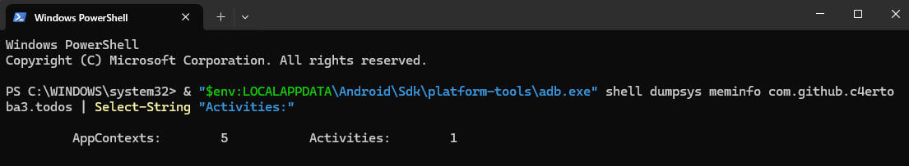
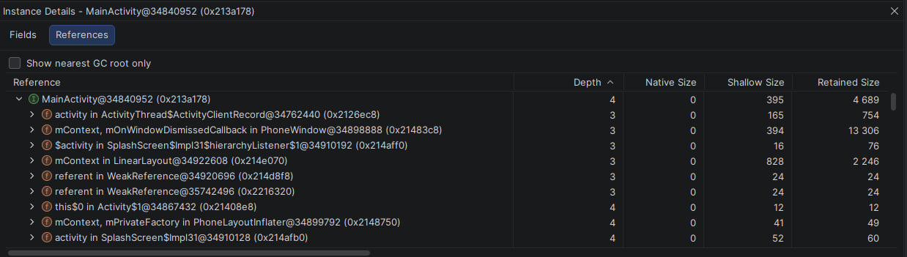
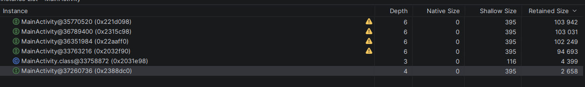

### Усложнение 1. Анализ производительности и памяти

#### CPU Profiler
- Задача `Find CPU Hotspots (Java/Kotlin Method Recording)`.
- `MainActivity.onCreate` — ~103 мс Total, из них **Self = 0,135 мс**
  (~1% от общего времени записи).
- Тяжёлых циклов, блокировок CPU нет.

#### Heap Dump
- Задача `Analyze Memory Usage (Heap Dump)`.
- В `References` для `MainActivity` — только системные ссылки
  (`ActivityThread$ActivityClientRecord`, `PhoneWindow`, `WeakReference`).
- Ссылок из пользовательских синглтонов нет — утечек не обнаружено.

Скриншоты:

## Усложнение 2: намеренные утечка и тормоза

### Часть A. Утечка памяти

#### Симптом

После 5 поворотов экрана `dumpsys meminfo` показывает 5–6 живых Activity.
Число **не уменьшается** через 10 секунд — GC не может собрать.

В heap dump видно 5+ экземпляров `MainActivity`:

#### Решение

Убрал `LeakHolder.leaked.add(this)`. После починки:

-  После 5 поворотов: `Activities: 1`.

### Часть B. Тормоз

#### Симптом

В `MainActivity.onCreate` добавлен тяжёлый цикл на 500M итераций — он
блокирует главный поток на несколько секунд.

В Logcat видно фактическое время выполнения цикла:

CPU Profiler показывает, что `MainActivity.onCreate` занимает тысячи
миллисекунд `Self`-времени; на Flame Chart — широкий «столб» в `onCreate`:

#### Решение

Убрал цикл из `onCreate`. Правильное решение для реального кода —
вынести работу в `Dispatchers.Default` через корутины (модуль про
многопоточность). После починки `onCreate` Self снова < 1 мс
